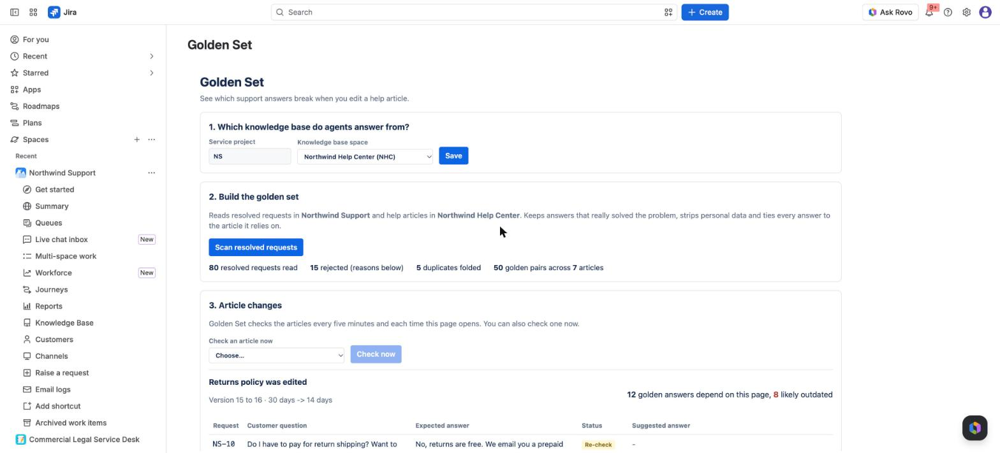
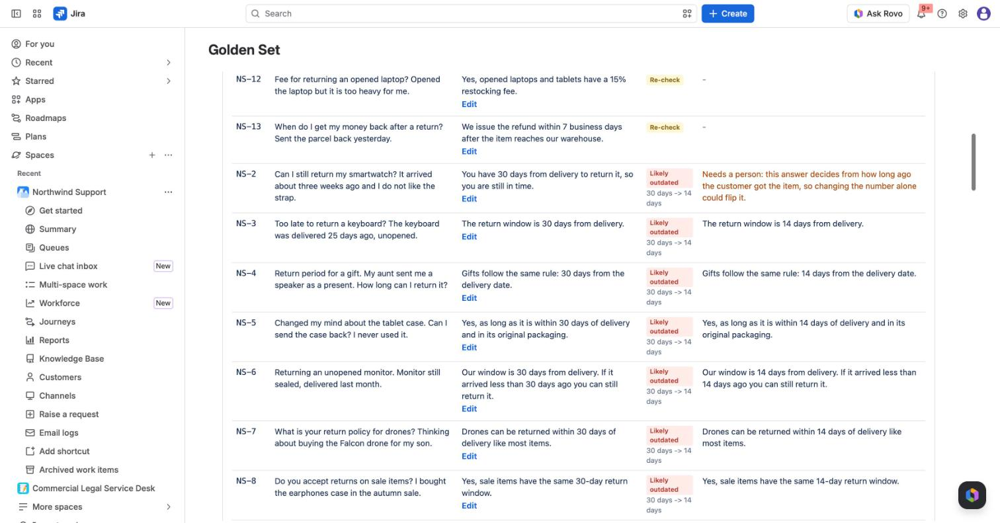
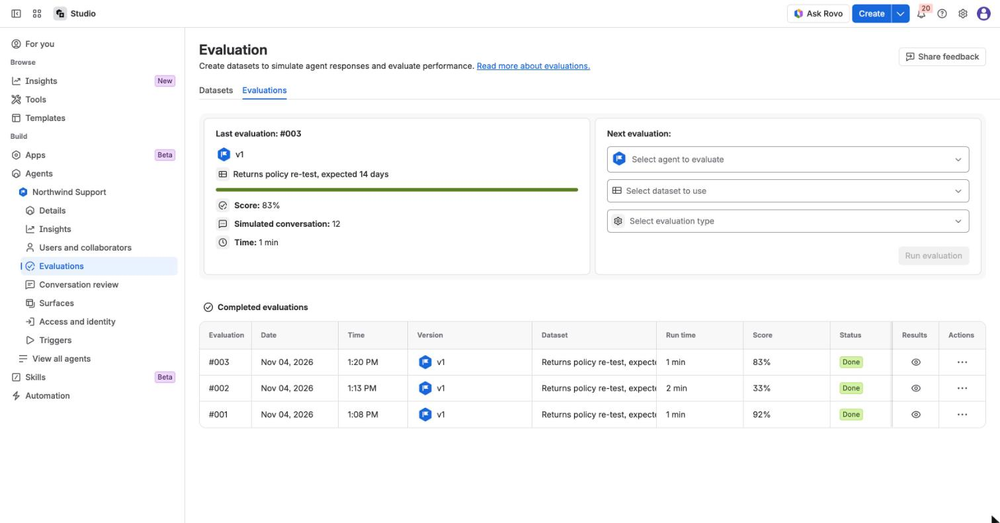

# Golden Set

See which support answers break when you edit a help article.

Golden Set is a Forge app for Jira Service Management, Confluence and Rovo. It reads resolved service requests, keeps the ones that were really solved (not reopened, no complaint after the answer, no low satisfaction rating), strips personal data and builds a golden set of up to 50 question and answer pairs. Each pair is tied to the Confluence article it relies on. When someone edits that article, Golden Set lists the answers that are now likely wrong, suggests corrected ones, and gives you a CSV to re-test your agent in Rovo Agent Evaluations.

No LLM runs on our side. Selection, linking and the edit check are deterministic, so they cost nothing and give the same result every time.

Demo video (2:27): https://youtu.be/FUgnW8DuiIU

Built for Atlassian Codegeist 2026.

**The proof.** Before any test ran, Golden Set flagged 8 of the 12 answers that rely on the Returns policy article. Rovo Agent Evaluations then failed exactly those 8: 92% before the edit, 33% after it, 83% after the suggested fixes. Demo data is synthetic (Northwind Gear, a fictional shop).







## What you get

- **A queue page in your service project** (Queues > Golden Set): pick the knowledge base space, scan resolved requests, review the golden pairs, see article edits with suggested answers, accept or reject them, download re-test CSVs.
- **A line under each Confluence article**, for example "Golden Set: 8 of 12 answers may be outdated". Counts only, never customer text.
- **A Rovo agent** with three read-only actions: list-article-impacts, get-article-pairs, get-retest-csv.
- **An MCP server** (rovo:mcp) with the same three tools, plus an open-source skill file for third-party agents: [skills/golden-set/SKILL.md](skills/golden-set/SKILL.md).

## Try it

Install link, one-click demo data and a 10 minute walkthrough with the numbers you should see: [docs/JUDGES.md](docs/JUDGES.md).

Our end-to-end run with Rovo Evaluations, 92% before the edit, 33% after it, 83% after the suggestions: [docs/E2E.md](docs/E2E.md).

## How it is built

| Folder | What is inside |
|---|---|
| `core/` | Pure JavaScript, no Forge imports: personal data redaction, answer cleanup, fact extraction (numbers, money, percentages, durations), article linking, scoring, deduplication, article diff and suggested answers. |
| `src/` | Forge side: resolvers, permission checks as the asking user, storage, the article check on every Confluence page update (with a five-minute safety net), Rovo actions, demo data loader. |
| `static/ui/` | The queue page (Custom UI, React). |
| `seed/` | Northwind Gear, a fictional shop: 6 help articles and 80 resolved requests, all synthetic. |
| `test/` | 126 unit tests, including a set of messy real-world-like requests. |

One installation covers Jira and Confluence (app compatibility: Jira required, Confluence optional), so storage, permissions and the Rovo agent are shared.

## Run the core locally

```
npm install
npm test
node seed/generate.mjs && node seed/verify.mjs
node tools/demo.mjs
```

## Deploy your own copy

```
npm install
npm run ui:build
forge register
forge deploy
forge install
```

## License

MIT, see [LICENSE](LICENSE).
